<h2>TensorFlow-FlexUNet-Image-Segmentation-Glioblastoma-T2W (2026/10/22)</h2>
<h3>Glioblastoma-T2W: AI Generated Pseudo Masks Segmentation Challenge</h3>
Sarah T. Arai 
Software Laboratory antillia.com  
This is the first experiment of Image Segmentation for <b>Glioblastoma-T2W-MRI</b> based on 
our <a href="https://github.com/sarah-antillia/TensorFlow-FlexUNet-Image-Segmentation-Model">
TensorFlowFlexUNet</a>
 (<b>TensorFlow Flexible UNet Image Segmentation Model for Multiclass</b>), and a 512x512 pixels PNG
 <a href="https://drive.google.com/file/d/1sVEAnfVawYeZNfY9hFJyFd-jcVW_DAp4/view?usp=sharing">
Augmented-Glioblastoma-T2W-ImageMask-Dataset.zip</a> with colorized masks 
(<a href="https://creativecommons.org/publicdomain/zero/1.0/">
CC0: Public Domain</a>), which was derived by us from  the Kaggle   
<a href="https://www.kaggle.com/datasets/keeplershaurya/mri-glioblastoma">
MRI Glioblastoma
</a> SHAURYASINGH
  

<b>Actual Image Segmentation for Glioblastoma-T2W Images of 512x512 pixels</b> 
As shown below, the inferred masks predicted by our segmentation model trained by the dataset appear somewhat similar to the 
ground truth masks, but they lack precision in certain areas.
  
<b>class_color_map = {NCR (Necrotic Tumor Core):red, ED (Edema):green, ET (Enhancing Tumor):blue}</b>
  
<table>
<tr>
<th>Input: image</th>
<th>Mask (ground_truth)</th>
<th>Prediction: inferred_mask</th>
</tr>
<tr>
<td>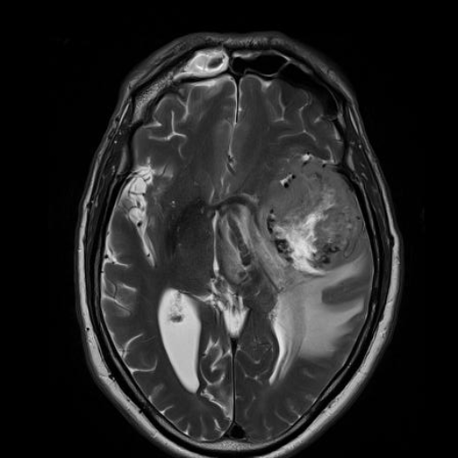</td>
<td>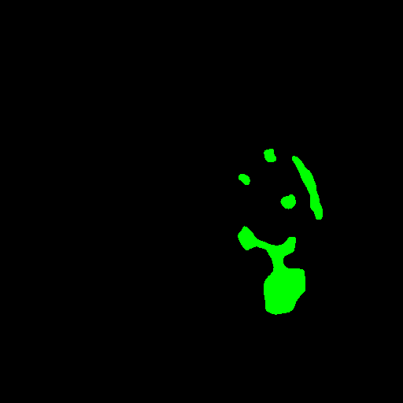</td>
<td>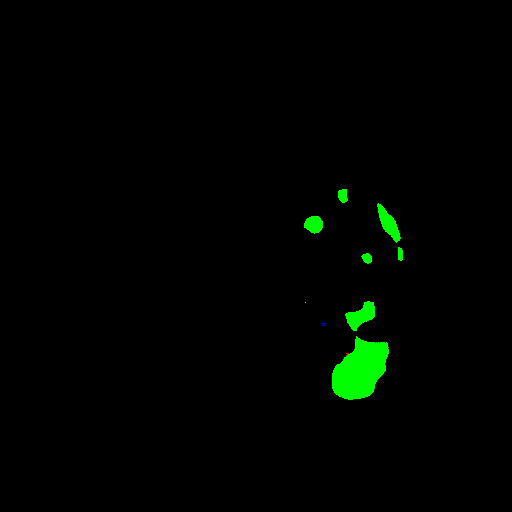</td>
</tr>

<tr>
<td>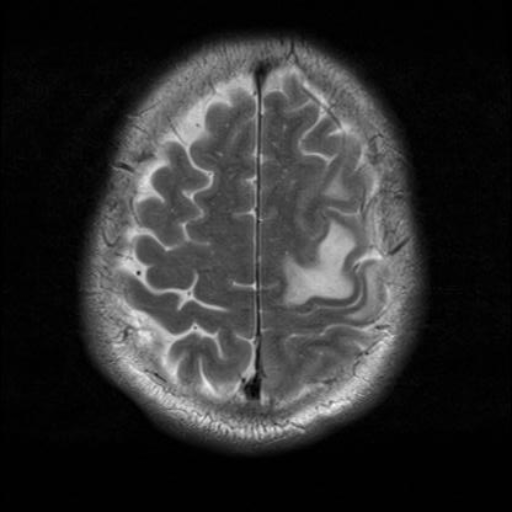</td>
<td>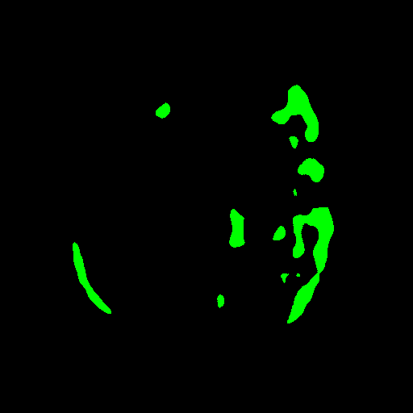</td>
<td>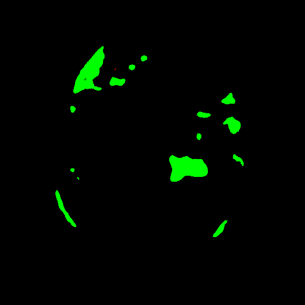</td>
</tr>

<tr>
<td>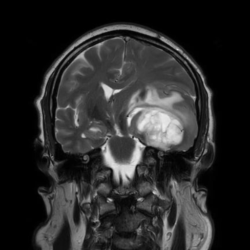</td>
<td>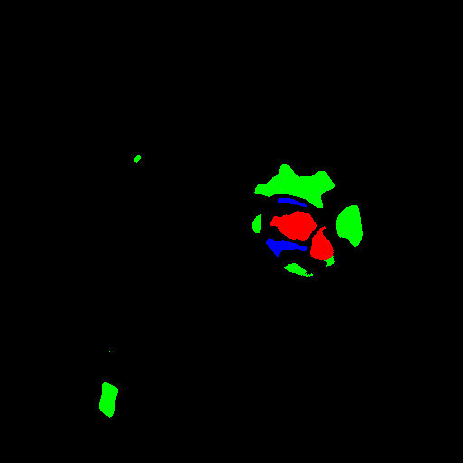</td>
<td>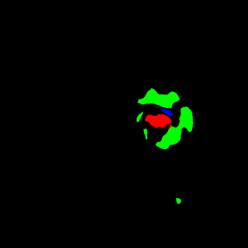</td>
</tr>
</table>

 
<h3>1. Dataset Citation</h3>
The image dataset used here was taken from   
<a href="https://www.kaggle.com/datasets/keeplershaurya/mri-glioblastoma">
<b>MRI Glioblastoma</b>
</a>  
<b>Real-world Multi-Institutional Glioblastoma MRI Dataset
</b> by  SHAURYASINGH
  
The following explanation was taken from the website sbove.
  
<b>About Dataset</b> 
This dataset includes raw and processed MRI data from a multi-center study of primary glioblastoma, collected across eight collaborating hospitals. Data were acquired between 2018 and 2025. Participants were adults with histologically confirmed primary glioblastoma who underwent preoperative neuroimaging before surgery.
 <br.>
The dataset contains T1-weighted (pre- and post-contrast), T2-weighted, and FLAIR MRI sequences for all subjects. Anatomical scans were defaced using PyDeface.
  
Raw MRI data are provided for 337 patients, organized in BIDS folders labeled sub-/site-code/-000. In each case, sub-XXX_run-01_T1w.nii.gz file represents pre-contrast T1-WI, and sub-XXX_run-02_T1w.nii.gz - T1-WI series obtained after Gd injection.
  
<b>Original Data</b> 
<a href="https://openneuro.org/datasets/ds007045/versions/1.0.1">
<b>Real-world Multi-Institutional Glioblastoma MRI Dataset with Standardized Preprocessing, 
 Expert-Validated Segmentation, and MGMT Promoter Profiling</b>
</a>
  
<b>License</b> 
<a href="https://creativecommons.org/publicdomain/zero/1.0/">
CC0: Public Domain</a>
 
 
<h3>2 Glioblastoma-T2W ImageMask Dataset</h3>
<h3>2.1 Download Glioblastoma-T2W Dataset</h3>
 If you would like to train this Glioblastoma-T2W Segmentation model,
 please download the dataset from the google drive our downscaled 
 <a href="https://drive.google.com/file/d/1sVEAnfVawYeZNfY9hFJyFd-jcVW_DAp4/view?usp=sharing">
Augmented-Glioblastoma-T2W-ImageMask-Dataset.zip</a> 
(<a href="https://creativecommons.org/publicdomain/zero/1.0/">
CC0: Public Domain</a>).
Expand the downloaded ImageMaskDataset and put it under <b>./dataset</b> folder to be:
 
<pre>
./dataset
└─Glioblastoma-T2W
    ├─test
    │   ├─images
    │   └─masks
    ├─train
    │   ├─images
    │   └─masks
    └─valid
        ├─images
        └─masks
</pre>
 
<b>Glioblastoma-T2W Statistics</b> 
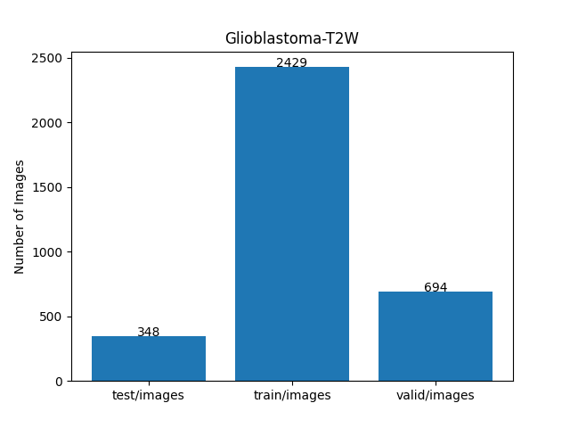 
  
As shown above, the number of images of train and valid datasets is large enough to use for the
 training set of our segmentation model.
  
<h4>2.2 Derivation of ImageMask Dataset</h4>
The folder structure of <b>MRI-Glioblastoma</b> is as follows, but it contains no corresponding annotation files. 
<pre>
./Glioblastoma_MRI_Dataset
  ├─sub-BO107
  │  └─anat
  │      ├─sub-BO107_FLAIR
  │      ├─sub-BO107_run-01_T1w
  │      ├─sub-BO107_run-02_T1w
  │      └─sub-BO107_T2w
...
  └─sub-TO015
     └─anat
         ├─sub-TO015_FLAIR
         ├─sub-TO015_run-01_T1w
         ├─sub-TO015_run-02_T1w
         └─sub-TO015_T2w
</pre>
<b>Step 1</b> 
We generated a 512x512-pixel cropped PNG master <b>Glioblastoma T2W</b> dataset 
from JPG files in all <b>sub-*/anat/sub*_T2w</b> subfolders.
  
<b>Step 2</b> 
We generated the first pseudo masks by applying a
segmentation (inference) method of a pretrained Glioblastoma FlexUNet model 
<a href="https://github.com/sarah-antillia/TensorFlow-FlexUNet-Image-Segmentation-Mendeley-Glioblastoma-Multiforme-MRI">
TensorFlow-FlexUNet-Image-Segmentation-Mendeley-Glioblastoma-Multiforme-MRI 
</a> to the Glioblastoma T2W images.  
We also used the following class color mapping table for Glioblastoma three classes.  
<table border="1" style="border-collapse: collapse;">
<tr><th>Index</th><th>Category</th><th>Color </th><th>RGB triplet</th></tr>
<tr>
<td>1</td><td>NCR(Necrotic Tumor Core)</td><td>red</td><td>(255,0,0)</td>
</tr>
<tr>
<td>2</td><td>ED (Peritumoral Edema)</td><td>green</td><td>(0,255,0)</td>
</tr>
<tr>
<td>3</td><td>ET (Enhancing Tumor)</td><td>blue</td><td>(0,0,255)</td>
</tr>
</table>
  
<b>Step 3</b> 
We generated a PNG augmented ImageMask Dataset from the pairs of master images and
the  pseudo masks by using an image flipping tools.  
<b>Step 4</b> 
We generated a FlexUNet segmentation  model by using the augmented dataset.
  
<b>Step 5</b> 
We generated new pseudo masks by applying a
segmentation (inference) method of the pretrained FlexUNet model.
  
We iteratively repeated Steps 3 to 5 three times to generate our curated 
<a href="https://drive.google.com/file/d/1sVEAnfVawYeZNfY9hFJyFd-jcVW_DAp4/view?usp=sharing">Augmented-Glioblastoma-T2W-ImageMask-Dataset</a>.
    
<h3>2.3 Train Sample Images and Masks</h3>
<b>Train sample images</b> 
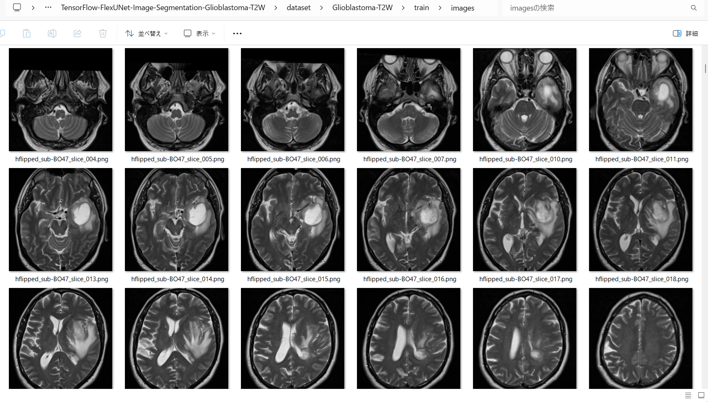
 
<b>Train sample masks</b> 
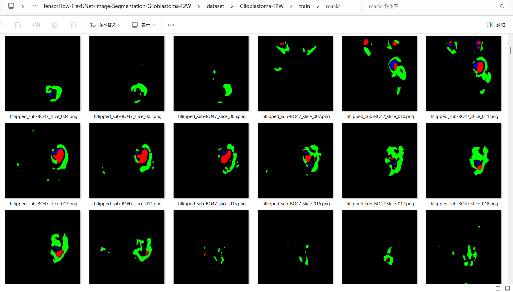
 
<h3>3 Train TensorFlowFlexUNet Model</h3>
 We trained Glioblastoma-T2W TensorFlowFlexUNet Model by using the 
<a href="./projects/TensorFlowFlexUNet/Glioblastoma-T2W/train_eval_infer.config"> <b>train_eval_infer.config</b></a> file.  
Please move to ./projects/TensorFlowFlexUNet/Glioblastoma-T2W and run the following bat file. 
<pre>
>1.train.bat
</pre>
, which simply runs the following command. 
<pre>
>python ../../../src/TensorFlowFlexUNetTrainer.py ./train_eval_infer.config
</pre>

<b>Model parameters</b> 
Defined a small <b>base_filters = 16 </b> and large <b>base_kernels = (11,11)</b> for the first Conv Layer of Encoder Block of 
<a href="./src/TensorFlowFlexUNet.py">TensorFlowFlexUNet.py</a> 
and a large num_layers (including a bridge between Encoder and Decoder Blocks).
<pre>
[model]
;You may specify your own UNet class derived from our TensorFlowFlexModel
model         = "TensorFlowFlexUNet"
image_width    = 512
image_height   = 512
image_channels = 3
input_normalize = True
normalization  = False
num_classes    = 4
base_filters   = 16
base_kernels   = (11,11)
num_layers     = 8
dropout_rate   = 0.05
dilation       = (1,1)
</pre>
<b>Learning rate</b> 
Defined a small learning rate.  
<pre>
[model]
learning_rate  = 0.00007
</pre>
<b>Loss and metrics functions</b> 
Specified "categorical_focal_dice_loss" and <a href="./src/dice_coef_multiclass.py">"dice_coef_hybrid"</a>. 
<pre>
[model]
loss           = "categorical_focal_dice_loss"
metrics        = ["dice_coef_hybrid"]
hybrid_alpha   = 1.6
hybrid_beta    = 0.4
</pre>
<b>Dataset class</b> 
Specifed <a href="./src/ImageCategorizedMaskDataset.py">ImageCategorizedMaskDataset</a> class. 
<pre>
[dataset]
class_name    = "ImageCategorizedMaskDataset"
</pre>
 
<b>Learning rate reducer callback</b> 
Enabled learning_rate_reducer callback, and a small reducer_patience.
<pre> 
[train]
learning_rate_reducer = True
reducer_factor     = 0.5
reducer_patience   = 5
</pre>
<b>Early stopping callback</b> 
Enabled early stopping callback with patience parameter.
<pre>
[train]
patience      = 10
</pre>
<b>RGB Color map</b> 
Specified RGB color map dict for Glioblastoma-T2W 1+3 classes. 
<pre>
[mask]
mask_datatype    = "categorized"
mask_file_format = ".png"
;Glioblastoma-T2W RGB color map dict for 1+3 classes.
rgb_map = {(0,0,0):0, (255,0,0):1, (0,255,0):2, (0,0,255):3,}
</pre>
<b>Epoch change inference callback</b> 
Enabled <a href="./src/EpochChangeInferencer.py">epoch_change_infer callback</a></b>. 
<pre>
[train]
epoch_change_infer       = True
epoch_change_infer_dir   =  "./epoch_change_infer"
num_infer_images         = 6
</pre>
By using this callback, on every epoch_change, the inference procedure can be called
 for 6 images in <b>mini_test</b> folder. This will help you confirm how the predicted mask changes 
 at each epoch during your training process.  
  
As shown below, early in the model training, the predicted masks from our FlexUNet segmentation model showed 
discouraging results. However, as training progressed through the epochs, the predictions gradually improved. 
   
<b>Epoch_change_inference output at starting (epoch 1,2,3)</b> 
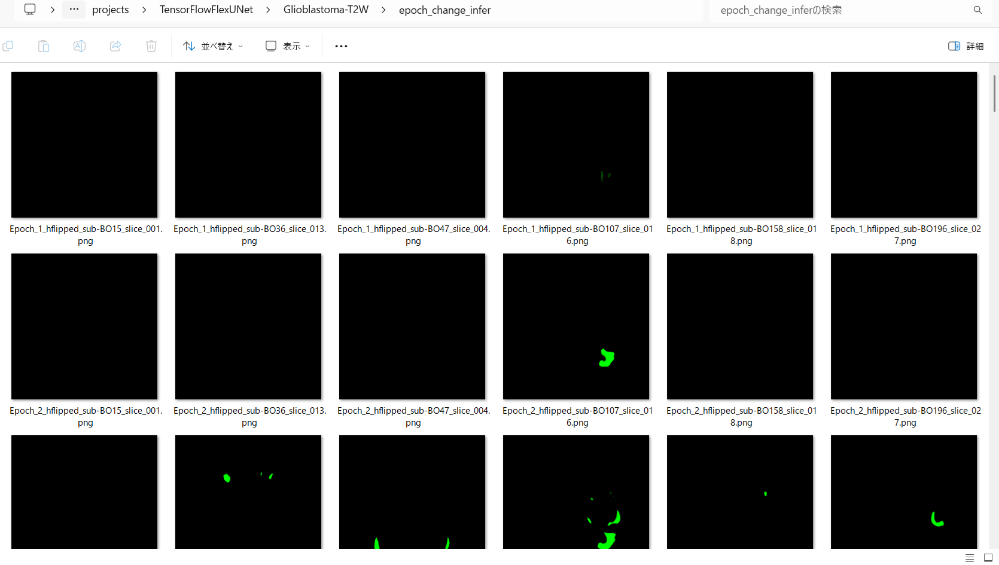 
 
<b>Epoch_change_inference output at middlepoint (epoch 15,16,17)</b> 
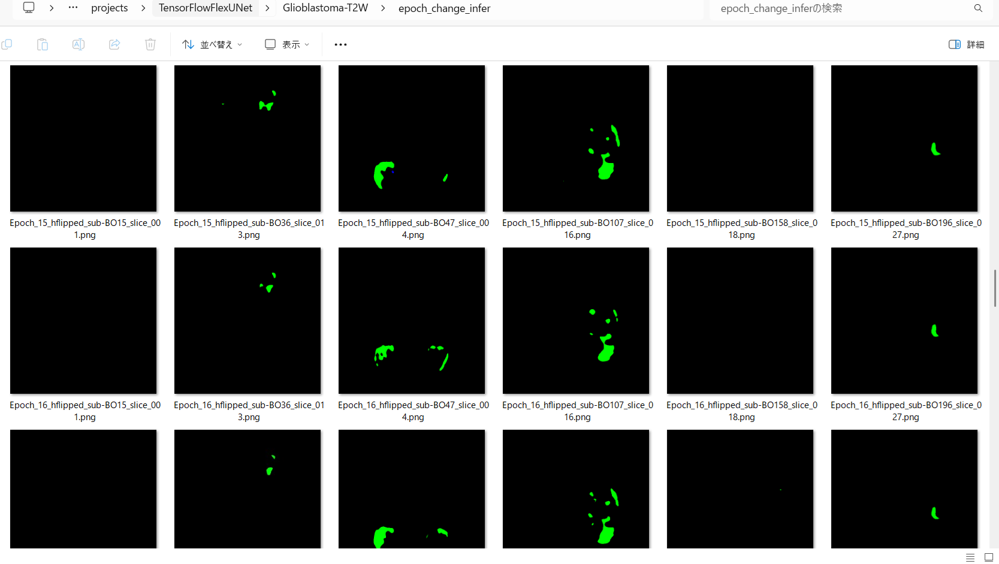 
 
<b>Epoch_change_inference output at ending (epoch 31,32,33)</b> 
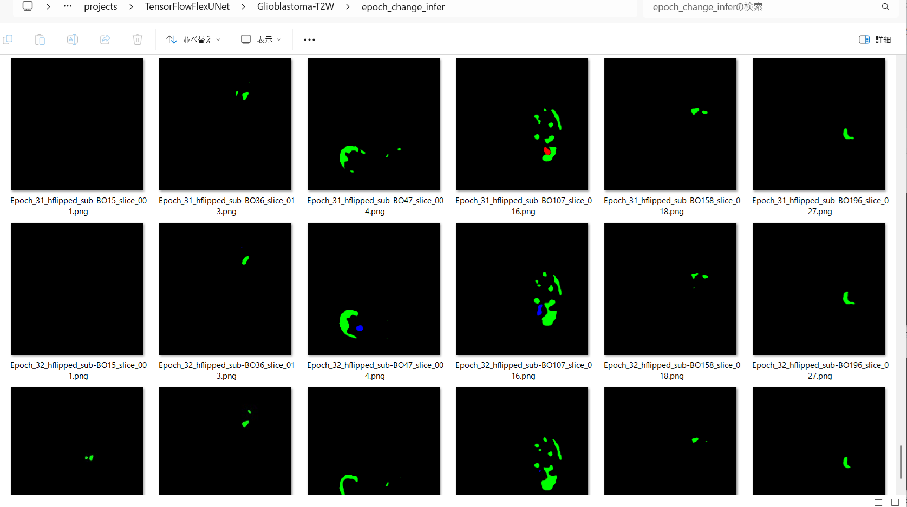 
 
In this experiment, the training process was terminated at epoch 33.  
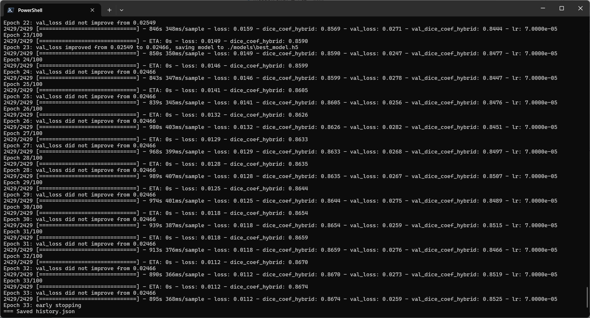 
 
<a href="./projects/TensorFlowFlexUNet/Glioblastoma-T2W/eval/train_metrics.csv">train_metrics.csv</a> 
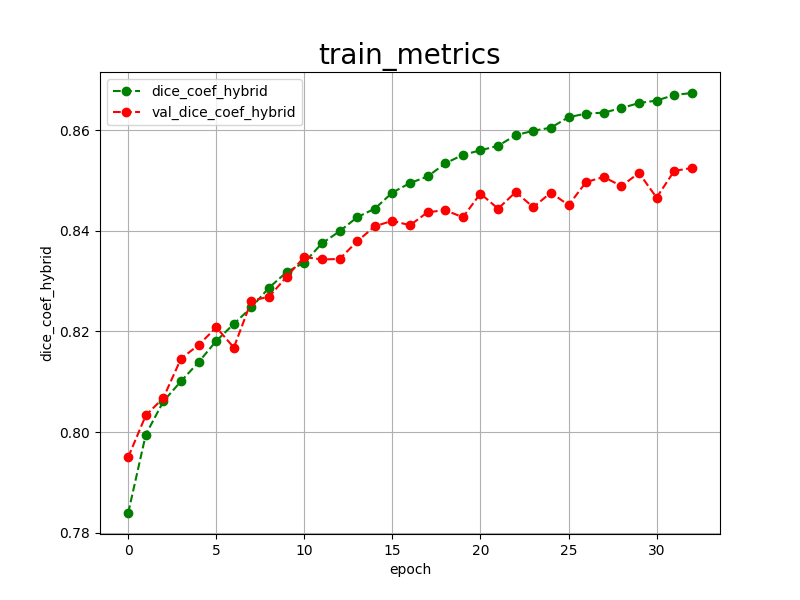 
 
<a href="./projects/TensorFlowFlexUNet/Glioblastoma-T2W/eval/train_losses.csv">train_losses.csv</a> 
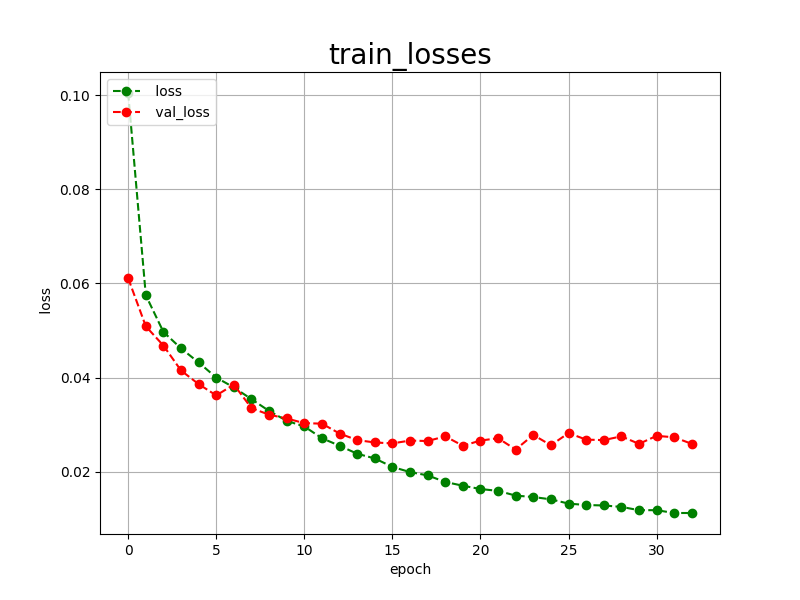
 
<h3>
4 Evaluation
</h3>
Please move to <b>./projects/TensorFlowFlexUNet/Glioblastoma-T2W</b> folder, 
and run the following bat file to evaluate TensorFlowUNet model for Glioblastoma-T2W. 
<pre>
>./2.evaluate.bat
</pre>
This bat file simply runs the following command.
<pre>
>python ../../../src/TensorFlowFlexUNetEvaluator.py ./train_eval_infer.config
</pre>
Evaluation console output: 

  Image-Segmentation-Glioblastoma-T2W
<a href="./projects/TensorFlowFlexUNet/Glioblastoma-T2W/evaluation.csv">evaluation.csv</a> 
The loss (categorical_focal_dice_loss) to this <b>Glioblastoma-T2W/test</b> was low, 
but dice_coef_hybrid was not high as shown below.
 
<pre>
categorical_focal_dice_loss,0.0258
dice_coef_hybrid,0.8441
</pre>
 
<h3>
5 Inference
</h3>
Please move to a <b>./projects/TensorFlowFlexUNet/Glioblastoma-T2W</b> folder, and run the following bat file to infer segmentation regions for images by the Trained-TensorFlowUNet model for Glioblastoma-T2W. 
<pre>
>./3.infer.bat
</pre>
This simply runs the following command.
<pre>
>python ../../../src/TensorFlowFlexUNetInferencer.py ./train_eval_infer.config
</pre>

<b>mini_test_images</b> 
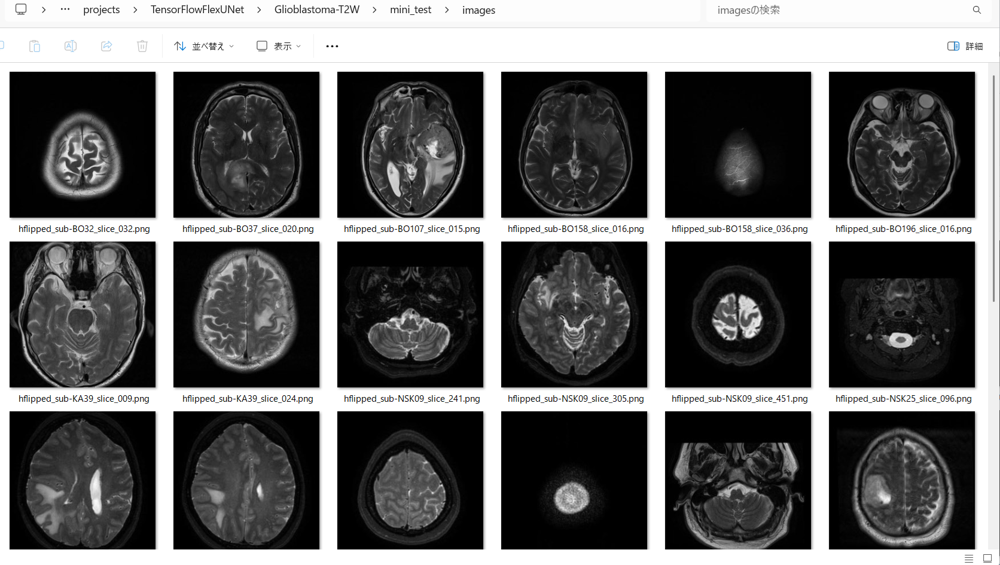 
<b>mini_test_mask(ground_truth)</b> 
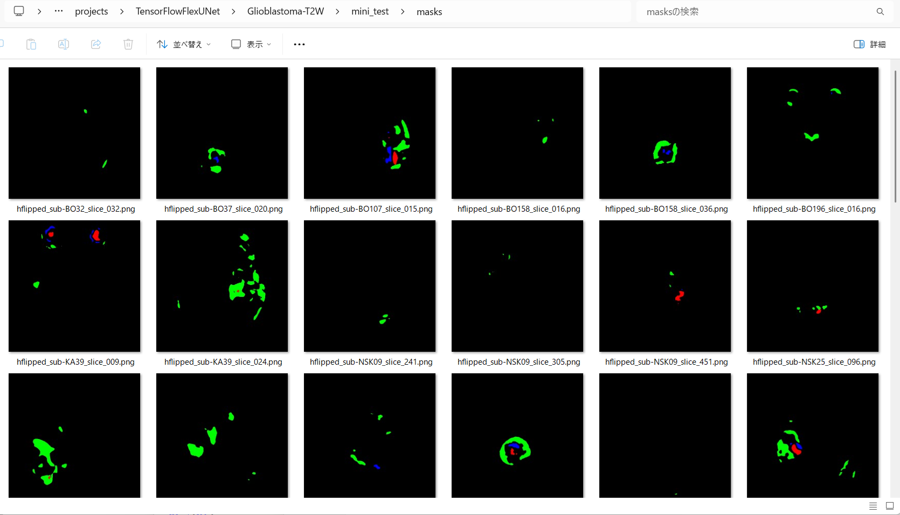 

<b>Inferred test masks</b> 
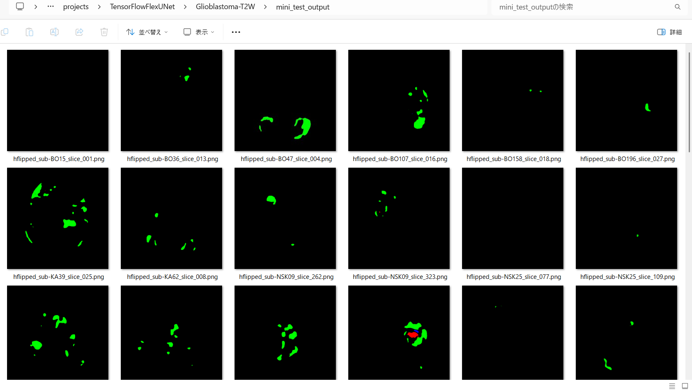 
 

<b>Enlarged images and masks of Glioblastoma-T2W Images of 512x512 pixels</b> 
As shown below, the inferred masks predicted by our segmentation model trained by the dataset appear somewhat similar to the 
ground truth masks, but they lack precision in certain areas.
  
<b>class_color_map = {NCR (Necrotic Tumor Core):red, ED (Edema):green, ET (Enhancing Tumor):blue}</b>
  
<table>
<tr>
<th>Input:Image</th>
<th>Mask (ground_truth)</th>
<th>Prediction:Inferred-mask</th>
</tr>
<tr>
<td>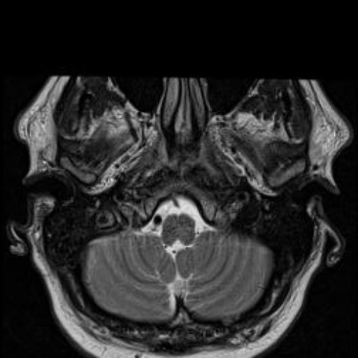</td>
<td>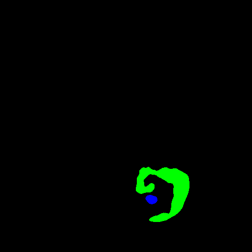</td>
<td>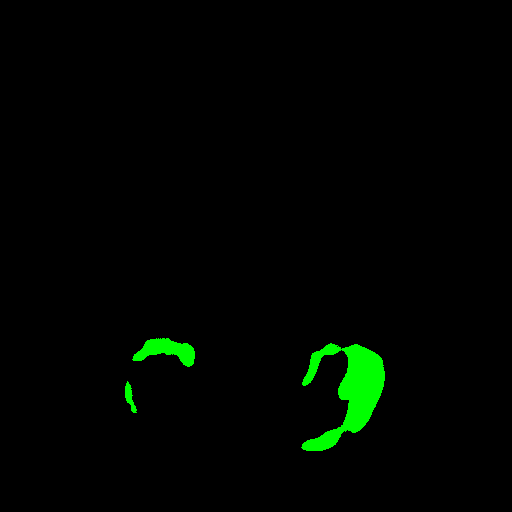</td>
</tr>

<tr>
<td>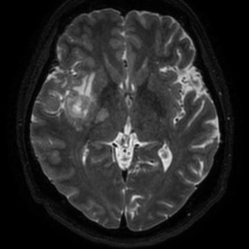</td>
<td>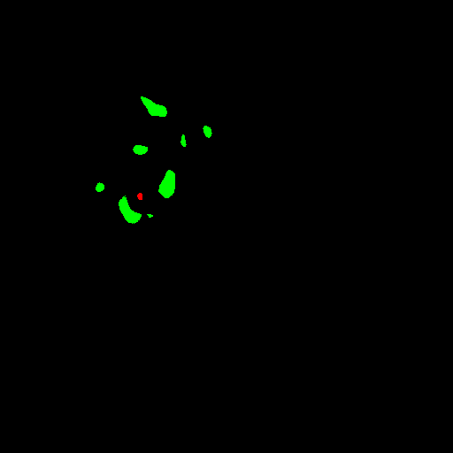</td>
<td>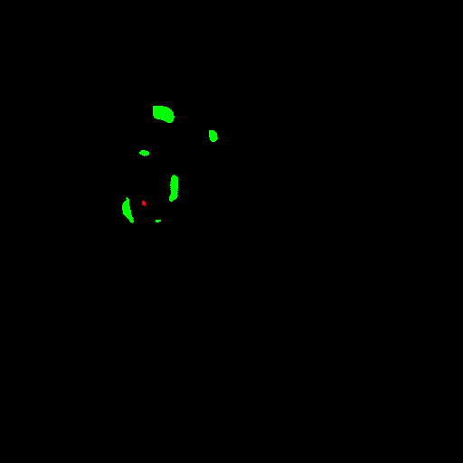</td>
</tr>

<tr>
<td>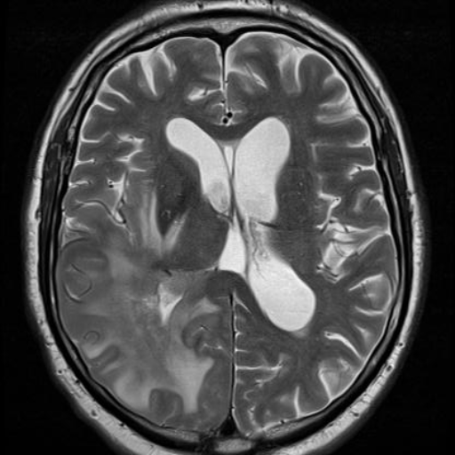</td>
<td>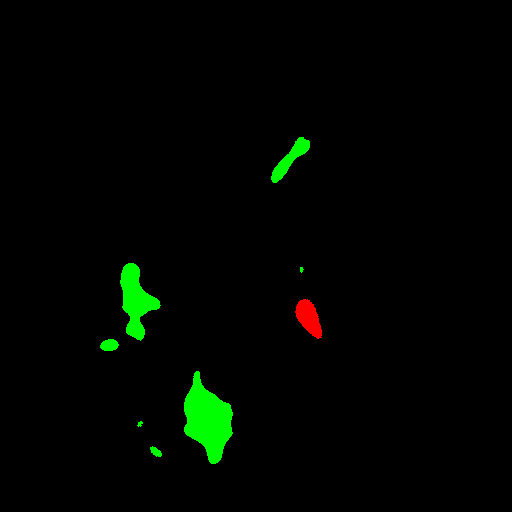</td>
<td>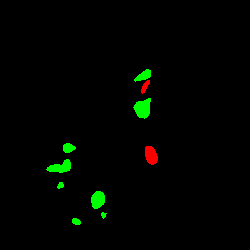</td>
</tr>

<tr>
<td>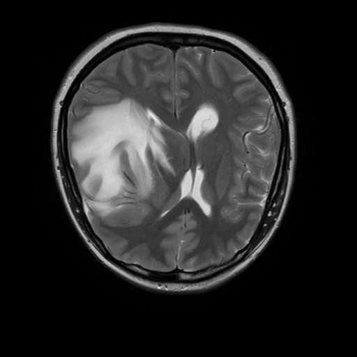</td>
<td>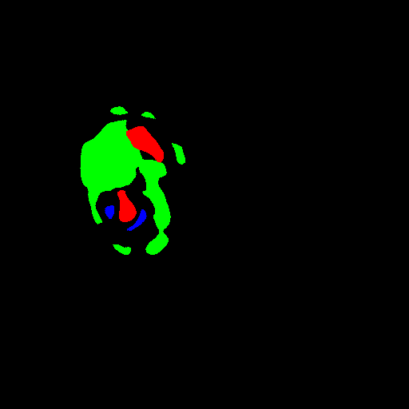</td>
<td>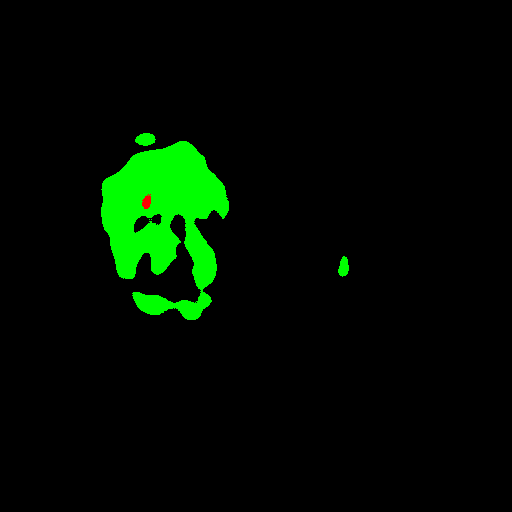</td>
</tr>

<tr>
<td>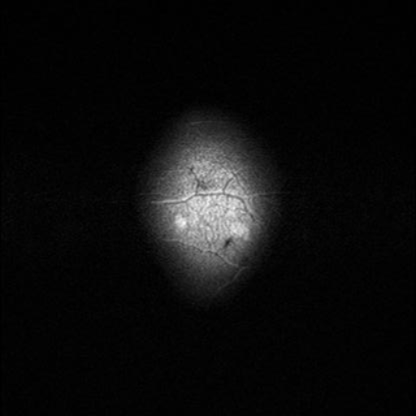</td>
<td>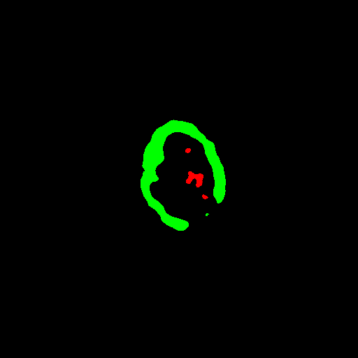</td>
<td>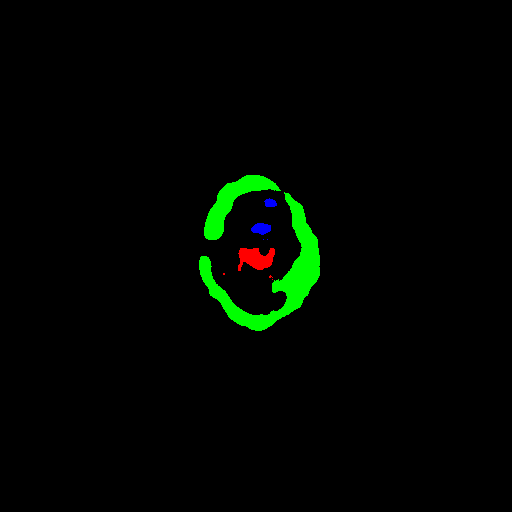</td>
</tr>

<tr>
<td>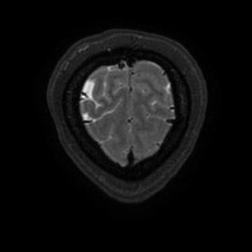</td>
<td></td>
<td>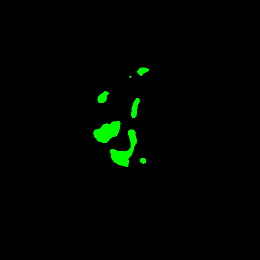</td>
</tr>
</table>

 
<h3>
References
</h3>
<b>1. The Brain Tumor Segmentation (BraTS) Challenge 2023: Glioma Segmentation in Sub-Saharan Africa Patient 
Population (BraTS-Africa)</b> 
Maruf Adewole, Jeffrey D. Rudie, Anu Gbadamosi, Oluyemisi Toyobo, Confidence Raymond, Dong Zhang, 
Olubukola Omidiji, Rachel Akinola, Mohammad Abba Suwaid, Adaobi Emegoakor, Nancy Ojo, Kenneth Aguh,  
Chinasa Kalaiwo, Gabriel Babatunde, Afolabi Ogunleye, Yewande Gbadamosi, Kator Iorpagher, Evan Calabrese, 
Mariam Aboian, Marius Linguraru, Jake Albrecht, Benedikt Wiestler, Florian Kofler, Anastasia Janas, 
Dominic LaBella, Anahita Fathi Kzerooni, Hongwei Bran Li, Juan Eugenio Iglesias, Keyvan Farahani,  
James Eddy, Timothy Bergquist, Verena Chung, Russell Takeshi Shinohara, Walter Wiggins, Zachary Reitman, 
Chunhao Wang, Xinyang Liu, Zhifan Jiang, Ariana Familiar, Koen Van Leemput, Christina Bukas, Maire Piraud, 
Gian-Marco Conte, Elaine Johansson, Zeke Meier, Bjoern H Menze, Ujjwal Baid, Spyridon Bakas, Farouk Dako, 
Abiodun Fatade, Udunna C Anazodo 
<a href="https://arxiv.org/pdf/2305.19369">https://arxiv.org/pdf/2305.19369</a>
  
<b>2. Advancing Precision: A Comprehensive Review of MRI Segmentation Datasets from BraTS Challenges (2012–2025)</b> 
Beatrice Bonato, Loris Nanni and Alessandra Bertoldo 
<a href="https://www.mdpi.com/1424-8220/25/6/1838">https://www.mdpi.com/1424-8220/25/6/1838</a>
  
<b>3. Multi-class glioma segmentation on real-world data with missing MRI sequences: comparison of three deep learning algorithms
</b> 
Hugh G. Pemberton, Jiaming Wu, Ivar Kommers, Domenique M. J. Müller, Yipeng Hu, Olivia Goodkin,  
Sjoerd B. Vos, Sotirios Bisdas, Pierre A. Robe, Hilko Ardon, Lorenzo Bello, Marco Rossi,  
Tommaso Sciortino, Marco Conti Nibali, Mitchel S. Berger, Shawn L. Hervey-Jumper, Wim Bouwknegt, 
Wimar A. Van den Brink, Julia Furtner, Seunggu J. Han, Albert J. S. Idema, Barbara Kiesel, 
Georg Widhalm, Alfred Kloet, Michiel Wagemakers, Aeilko H. Zwinderman, Sandro M. Krieg,  
Emmanuel Mandonnet, Ferran Prados, Philip de Witt Hamer, Frederik Barkhof & Roelant S. Eijgelaar 
<a href="https://www.nature.com/articles/s41598-023-44794-0">
https://www.nature.com/articles/s41598-023-44794-0
</a>
  
<b>4. Training 3D U-Net for Brain Tumor Segmentation Challenge – Medical Imaging</b> 
Jaykumaran 
<a href="https://learnopencv.com/3d-u-net-brats/">https://learnopencv.com/3d-u-net-brats/</a>
  
<b>5. TensorFlow-FlexUNet-Image-Segmentation-Mendeley-Glioblastoma-Multiforme-MRI</b> 
Toshiyuki Arai 
<a href="https://github.com/sarah-antillia/TensorFlow-FlexUNet-Image-Segmentation-Mendeley-Glioblastoma-Multiforme-MRI">
https://github.com/sarah-antillia/TensorFlow-FlexUNet-Image-Segmentation-Mendeley-Glioblastoma-Multiforme-MRI
</a>
  
<b>6. TensorFlow-FlexUNet-Image-Segmentation-UTSW-Glioma-T2W-Subset</b> 
Toshiyuki Arai 
<a href="https://github.com/sarah-antillia/TensorFlow-FlexUNet-Image-Segmentation-UTSW-Glioma-T2W-Subset">
https://github.com/sarah-antillia/TensorFlow-FlexUNet-Image-Segmentation-UTSW-Glioma-T2W-Subset
</a>
  
<b>7. TensorFlow-FlexUNet-Image-Segmentation-Multiclass-BraTS2023-Subset</b> 
Toshiyuki Arai 
<a href="https://github.com/sarah-antillia/TensorFlow-FlexUNet-Image-Segmentation-Multiclass-BraTS2023-Subset">
https://github.com/sarah-antillia/TensorFlow-FlexUNet-Image-Segmentation-Multiclass-BraTS2023-Subset
</a>
  
<b>8. TensorFlow-FlexUNet-Image-Segmentation-Multiclass-BraTS2020</b> 
Toshiyuki Arai 
<a href="https://github.com/sarah-antillia/TensorFlow-FlexUNet-Image-Segmentation-Multiclass-BraTS2020">
https://github.com/sarah-antillia/TensorFlow-FlexUNet-Image-Segmentation-Multiclass-BraTS2020
</a>
  
<b>9. TensorFlow-FlexUNet-Image-Segmentation-Brain-Tumor-BraTS2019-HGG-LGG-MRI</b> 
Toshiyuki Arai 
<a href="https://github.com/sarah-antillia/TensorFlow-FlexUNet-Image-Segmentation-Brain-Tumor-BraTS2019-HGG-LGG-MRI">
https://github.com/sarah-antillia/TensorFlow-FlexUNet-Image-Segmentation-Brain-Tumor-BraTS2019-HGG-LGG-MRI
</a>
  
<b>10. TensorFlow-FlexUNet-Image-Segmentation-Model</b> 
Toshiyuki Arai  
<a href="https://github.com/sarah-antillia/TensorFlow-FlexUNet-Image-Segmentation-Model">
https://github.com/sarah-antillia/TensorFlow-FlexUNet-Image-Segmentation-Model
</a>
 
 
